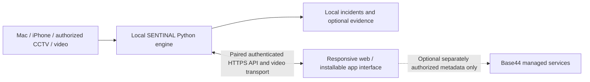

> Historical feasibility note. The implemented V0.3 integration and executed deployment results are described in `CONNECTED_V03.md` and the current root verification report. This note predates that work.

# SENTINAL website and app: Base44 feasibility

Assessed November 3, 2026, from current official Base44 documentation. This is an architecture assessment, not a deployed website or an integration test. No project code, camera frames, credentials, evidence or databases were uploaded to Base44.

**Yes: a Base44 website and installable phone interface are feasible as a future presentation layer. Keep the local SENTINAL inference/camera service. A Base44-only conversion does not establish the required offline Mac/MPS/ONVIF/RTSP behavior.**

Base44 documents mobile-browser access, Add to Home Screen, and app-store submission. Phone camera/photo/video features are documented for use while the app is open and after permission. Its managed backend supports data, authentication, functions and hosting. Server-side functions run on TypeScript/Deno; these are not the Python/PyTorch/MPS process currently running on the Mac. The conclusion that we should retain the local engine is an engineering inference from those capabilities and SENTINAL's hardware/privacy requirements, not a published Base44 guarantee.

| Requirement | Suitable approach | Validation still needed |
| --- | --- | --- |
| Website and phone app-like interface | Responsive Base44 dashboard, home-screen installation; consider store packaging later | Actual browser/phone layout, camera permission and review flow |
| Mac/iPhone local camera choice | Existing exact-device native adapter, or browser video device selection after permission | Continuity enumeration, platform behavior, explicit selection |
| CCTV list and multiple RTSP cameras | Local Python companion owns ONVIF discovery, authorized RTSP decode and bounded inference | Authenticated local API, TLS, stream format conversion and multiple-camera load |
| Weapon/fire/smoke inference | Reuse loaded SENTINAL Python models on MPS/CPU | End-to-end browser video/event timing; existing model quality limits remain |
| Phone camera used as a remote feed | Permission-based WebRTC capture to a paired local companion | iOS foreground/background behavior, HTTPS and same-network connectivity |
| Human review/history | Local SQLite via authenticated companion; optional selected cloud metadata only after separate authorization | Roles, review audit, concurrent review, retention |
| Full offline operation and all files in this folder | Locally hosted/exported frontend and existing service | Remove/replace managed cloud dependencies and verify network-offline behavior |

Suggested boundary:

A cloud Base44 function cannot directly be assumed to reach cameras on a private home LAN. Browser camera access requires explicit permission and a secure context. Browser-to-LAN/loopback requests can have additional platform permissions, cross-origin and mixed-content restrictions. ONVIF UDP discovery and RTSP decoding should remain in the local companion, with a browser-compatible video transport such as WebRTC selected and actually tested before claiming support. Never expose camera passwords or an unauthenticated capture/control endpoint publicly.

The current local-only storage instruction conflicts with putting incident databases, evidence or runtime state in managed cloud services. The recommended first experiment is a locally served responsive frontend against a paired local SENTINAL API. Base44 could help author the interface; verify exported frontend behavior and remaining SDK/cloud calls before adopting it. Keep the present desktop application available during migration. No new backend framework, remote notifications, account or paid plan was introduced in this update.

Official sources checked:

- [Base44 mobile experience](https://docs.base44.com/Building-your-app/Mobile-experience): browser and home-screen use; distinguishes Base44's own builder apps from the apps users create.
- [Base44 developer platform](https://base44.com/developers): managed backend, hosting and TypeScript/Deno functions with external API integration.
- [Base44 developer tools](https://docs.base44.com/documentation/building-your-app/developer-tools): code/export workflow; verify plan and backend dependencies before migrating.
- [Browser camera security requirements](https://developer.mozilla.org/en-US/docs/Web/API/MediaDevices/getUserMedia): secure contexts and permissions.
- [Browser local-network access](https://developer.mozilla.org/en-US/docs/Web/Security/Defenses/Local_network_access): browser-dependent local/loopback restrictions.

No Base44 account/project was connected or created. Store acceptance, continuous mobile monitoring, local offline operation of exported code, and the proposed bridge are unimplemented and untested. This assessment authorizes no cloud transfer of footage or records.
