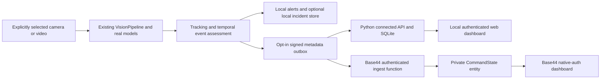

# SENTINAL V0.3 connected command center

This upgrade extends the existing Python desktop/inference application. It does not replace its camera adapters or run continuous CCTV inference inside Base44. The public website and private dashboard share reviewed presentation sources under `web/`; the designated hosted frontend is `frontend/command-center/`. Consult the current root `VERIFICATION_REPORT.md` for the final executed acceptance results and verified deployment URLs. Source presence alone does not establish deployment or hardware acceptance.

## Components and authority



Select one destination for a paired edge connection. The Python connected service is authoritative for its own users, device credentials, connected incidents, human review and audit. Base44 is authoritative for its native authenticated identities and the hosted command center's operational records. The desktop's original local incident/evidence store remains local. A stable event ID connects an outbound observation to its received incident; a cloud review does not silently rewrite the desktop incident database. These are explicit delivery boundaries, not uncontrolled bidirectional database synchronization.

The hosted prototype supports one organization, bounded records and one private `CommandState` entity with versioned atomic compare-and-update. Direct entity create/read/update/delete access is denied; authorized functions use service access after checking the human or device identity. The native authenticated owner is administrator. Other verified Base44 identities require an administrator's explicit membership grant. The application does not collect Base44 passwords. Viewer members can read; operators and administrators can review; membership, retention and device actions require administrator access. Do not interpret this single-organization prototype as audited multi-tenant production hosting.

## Start locally

Open `web.command` in the project root, or run:

```sh
./web.command
```

The first run prompts for a local administrator username and a password of at least 12 characters, then asks for confirmation. There is no default password. This local account is separate from Base44 sign-in. The launcher serves the public website at `http://127.0.0.1:8765/` and the private dashboard at `http://127.0.0.1:8765/app`. It pairs a local metadata device in `config/connected/edge-credentials.json` if none exists. The database is `recordings/connected/server.sqlite3`, and credentials/database remain owner-only inside this project. Starting this service opens no camera and creates no demonstration incidents.

`./web.command --no-browser` suppresses automatic browser opening. `--port <number>` selects a port; an existing paired file is not silently changed, so its backend origin must match the service you intentionally select. Use Control+C to stop the service. Non-loopback serving requires explicit HTTPS/TLS configuration; see [API_V03.md](API_V03.md).

## Connect the existing desktop application

1. Start the desktop with `launch.command`.
2. Open **Connected command center…**.
3. Choose **Load paired device file…** and select the owner-only configuration for the intended destination.
4. Inspect the backend origin and device identity, then explicitly enable **outbound incident metadata**.
5. Select the exact Mac/iPhone camera, authorized saved CCTV source, or a local video; press **Start** separately.
6. Check actual queued/delivered/failed counts and the dashboard's received camera/engine status.

Opening settings, loading a configuration and saving a configuration do not start capture or enable outbound delivery. The paired file preserves its selected transport route, timeout and retry settings. A Base44 pairing uses `/functions/ingest`; local Python uses `/api/edge/events`. Never place a device secret or camera password in a URL, screenshot, repository or public Drive snapshot. Disabling delivery does not stop the local monitor; stopping a camera does not claim its scene remains monitored. Normal application shutdown stops capture and delivery workers.

Each outbox is bound to the exact destination, device and credential fingerprint. Changing credentials or destination cannot forward an earlier destination's queued metadata. Queues, retries and record sizes are bounded. Metadata delivery is opt-in and includes model provenance, scores, boxes, logical camera IDs and measured health; it excludes camera addresses, camera credentials, images and audio.

## Hosted deployment and native sign-in

The hosted project source is intentionally isolated under `frontend/command-center/`, preserving the Python repository. Its pinned frontend dependencies are recorded in `package.json` and `package-lock.json`. `npm run build` first derives the public assets and adapted native-auth dashboard from `web/`, then builds the frontend. It replaces the local password form with Base44 native sign-in and email-based membership controls. Backend functions are `command` and `ingest`; the entity schema is `base44/entities/CommandState.jsonc`.

A deployment requires an authorized Base44 workspace, app binding, provisioned private state and owner secrets. Owner credentials are kept under the project-local CLI storage; they are excluded from Git and packages. Consult the final report for actual deployment verification instead of assuming a successful local build proves publishing. The website is public; operational data requires native sign-in and granted membership.

In the hosted dashboard, an administrator registers an authorized logical device. The one-time pairing configuration must be saved as an owner-only file under `config/connected/`, preferably `base44-edge-credentials.json` to distinguish it from the local pairing. The Base44 account and device signature are separate identities. Device registration alone does not activate any camera.

## Demo using actual inference

For a local browser demonstration, launch the local service, load its paired file in the desktop, enable delivery and use the existing **demo.command** moving-range clip. It is an attributed public-domain recording; the weapon boxes and incidents are genuine selected-model outputs. Press Start, then inspect the received incident's source, actual confidence, pinned model version and timestamp. Acknowledge or dismiss it and inspect its audit trail. A second authenticated browser session should see the stored review after refresh/polling. Local and hosted configurations must not be confused.

A headless equivalent for an explicitly selected local file is:

```sh
PROJECT_DIR="$PWD"
. "$PROJECT_DIR/runtime-env.sh"
.venv/bin/python -m sentinal.connected.monitor \
  --config config/connected/edge-credentials.json \
  --video data/v02-demo/weapon_range_motion.mp4 \
  --name "Authorized public moving video" --detectors weapons \
  --image-size 640 --alert-confidence .35 --persistence .3 --max-gap 2
```

These lower demonstration thresholds apply to this selected clip; they are not validated field settings or proof that false positives are eliminated. For the hosted command center, explicitly select the hosted pairing file instead. The edge sends only signed metadata over HTTPS. The monitor also accepts an exact camera device identity or an owner-only project file containing an authorized stream URL; it never guesses another camera.

Fire/smoke integration fixtures `fire_repeated_still.mp4` and `smoke_repeated_still.mp4` contain attributed real photographs repeated into video. They exercise genuine model loading, inference, temporal persistence and event delivery. They do not establish natural-motion fire/smoke recognition or independent real-world accuracy. The separate moving industrial-smoke miss and existing lookalike false positives remain documented.

## Video, notifications and privacy

Hosted live video delivery is not enabled. The hosted Live Monitoring page reports authorized inventory and connection status without exposing raw RTSP endpoints, private CCTV pixels or camera passwords. A browser-compatible secure video gateway would require a separately authorized and verified implementation.

The local Python service has a separate, explicitly enabled RAM-only recent-frame preview. Both the service's `--allow-local-preview` flag and the monitor's `--preview` flag are required. It is restricted to loopback, expires frames after three seconds, requires authenticated camera ownership and never persists images. It does not authorize cloud video transfer. The desktop-to-cloud metadata bridge does not upload video.

Browser sound is off by default, session-local and controlled by a user gesture, volume setting and cooldown. External recipients, mobile push, emergency-service calls and automatic accusations are not implemented. Operators must verify uncertain detections before consequential decisions. Incident retention defaults to seven days and is configurable from one to 365 days; retention and record caps are prototype policies, not certified secure deletion or immutable audit storage. Cameras and devices that stop or lose fresh health are explicitly inactive/offline.

The service worker caches public assets only; private API responses, incident records and previews must not enter its cache. Account changes clear private in-memory views and drafts. Authorized source snapshots exclude credentials, installed environments, build caches, private footage, databases and logs. Preserve the user's existing Drive sharing choice while uploading only reviewed distributable artifacts.

## Models, scope and verification

The upgrade reuses the actual selected models rather than treating a searchable catalog as a trained detector:

| Model | Source / supported interpretation |
| --- | --- |
| Ordinary objects | Official Ultralytics YOLO11n by default; existing OpenImages alternatives and optional YOLO11s remain |
| Possible weapons | [GingerBrains YOLOv8s repository](https://github.com/GingerBrains/object-detection/tree/ab6f53c8d18d77d799fa70a46adea646d7bb4499), pinned GPL-3.0 provenance; supported handgun/rifle/firearm/knife labels remain uncertain observations |
| Fire/smoke | [luminous0219 YOLOv8n repository](https://github.com/luminous0219/fire-and-smoke-detection-yolov8/tree/c30923f568d915a53fcf85989be9fe5d4e030518), pinned AGPL-3.0 provenance; visible flame/smoke only |

Exact hashes, class maps and license copies remain in [MODEL_MANIFEST_V02.md](MODEL_MANIFEST_V02.md), `models/v02/MODEL_MANIFEST.json` and [LICENSE_NOTES.md](../LICENSE_NOTES.md). Known precision/recall, false positives and false negatives remain in [DETECTION_RELIABILITY_V021.md](DETECTION_RELIABILITY_V021.md). A toy can trigger a possible-firearm prediction; no toy-versus-real, criminal intent, unknown chemical toxicity, invisible gas or certified fire-system capability is claimed. No newly validated broad sharp-object detector, GHS detector, fall/violence detector or unattended-bag feature is supplied by this connection layer.

Local unit, HTTP/HTTPS, real-inference and browser checks have distinct scopes. Browser device emulation is not physical iOS/Android/Windows acceptance. Existing Mac/iPhone/RTSP evidence is time- and hardware-specific. Use the current verification report for final passing/failing counts, measured throughput, hosted API results, actual published URLs and any remaining blockers.
